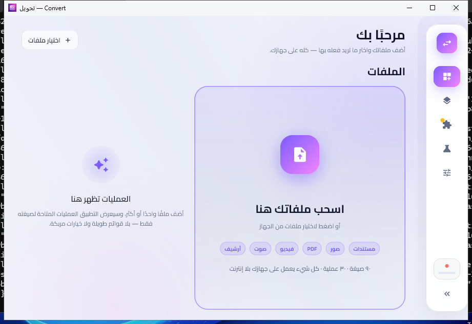
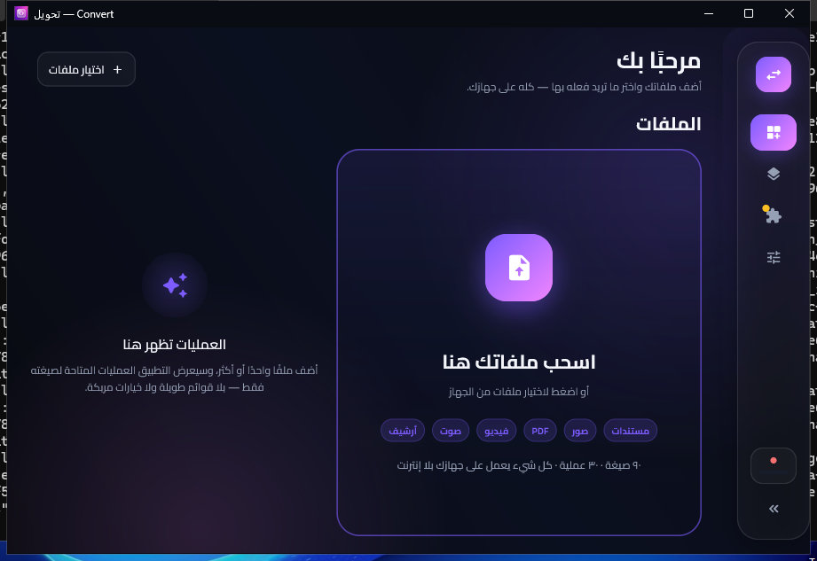
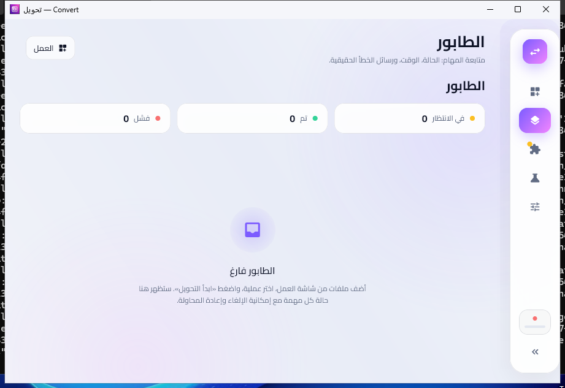
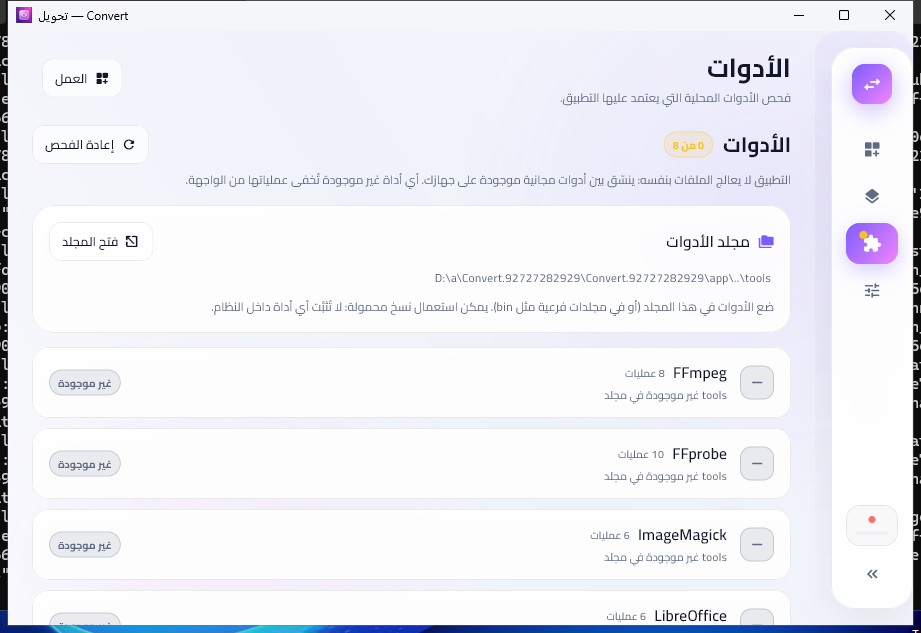
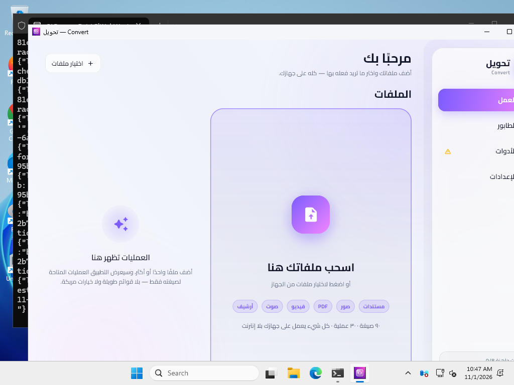
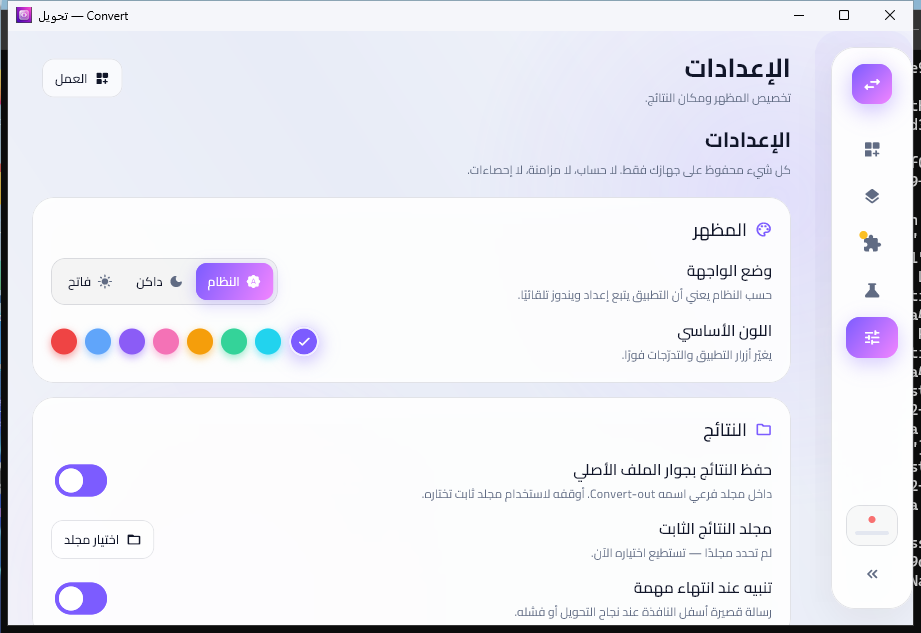

# تحويل — Convert

تطبيق سطح مكتب **لويندوز** مبني بـ **Flutter**، يجمع كل عمليات تحويل ومعالجة الملفات التي تحتاجها يوميًا في نافذة واحدة: مستندات، جداول، عروض، PDF، صور، فيكتور، فيديو، صوت، وأرشيف.

> **الفكرة المعمارية:** التطبيق لا يعالج الملفات بنفسه. هو **منسّق** بين سبع أدوات مجانية موجودة على جهازك (FFmpeg · ImageMagick · LibreOffice · 7-Zip · qpdf · Ghostscript · Poppler). الواجهة تستقبل الملف، تختار الأداة، تمرّر الأمر، وتعرض النتيجة.
>
> النتيجة: تطبيق صغير (~15 م.ب) لا يضم أي محرك، بلا إنترنت، بلا إعلانات، وبلا رفع أي ملف إلى أي جهة.

---

## لقطات من التطبيق

> كل اللقطات من النسخة المبنية **فعليًا** على ويندوز (CI)، لا من محاكي.

| الوضع الفاتح | الوضع الداكن |
|---|---|
|  |  |
|  |  |
|  |  |

---

## المزايا

| | |
|---|---|
| **٣٠ عملية** | من مستند → PDF إلى دمج المقاطع وضغط الأرشيف |
| **~٩٠ صيغة** | مدعومة فعليًا، لا «على الورق» |
| **نافذة واحدة فقط** | إذا كان التطبيق شغالًا، تشغيله مرة أخرى يُظهر النافذة القائمة ولا يفتح ثانية |
| **سحب وإفلات** | من مستكشف ويندوز مباشرة إلى النافذة (بما فيها الأسماء العربية والمسافات) |
| **طابور مهام** | مهمة واحدة في كل مرة، مع حالة ووقت ورسالة خطأ حقيقية |
| **إلغاء فوري** | يقتل الأداة وشجرة عملياتها (LibreOffice لا يعلّق التطبيق) |
| **مهلة ٢٠ دقيقة** | لكل عملية، حتى لا يبقى أي شيء عالقًا في الخلفية |
| **إخفاء ما لا يعمل** | إن كانت أداة غير موجودة، تختفي عملياتها — لا وعود كاذبة ولا أخطاء غامضة |
| **تخصيص كامل** | وضع داكن/فاتح/حسب النظام + ٨ ألوان أساسية تُغيّر هوية الواجهة بالكامل |
| **خصوصية مطلقة** | صفر اتصال بالشبكة، صفر تتبّع، صفر حسابات |

---

## التشغيل على ويندوز

### ١. متطلبات البناء

```powershell
flutter --version        # Flutter 3.22 أو أحدث
flutter doctor           # تأكد من Visual Studio (Desktop development with C++)
```

### ٢. البناء

```powershell
cd app
flutter pub get
flutter build windows --release
```

الناتج في:

```
app\build\windows\x64\runner\Release\
```

### ٣. الأدوات

انسخ مجلد `tools` (الذي فيه الملفات التنفيذية للأدوات السبع) **بجوار** `convert.exe`:

```
Release\
├── convert.exe
├── data\
└── tools\
    ├── ffmpeg.exe
    ├── ffprobe.exe
    ├── magick.exe
    ├── soffice.exe
    ├── 7z.exe
    ├── qpdf.exe
    ├── gswin64c.exe
    └── pdftotext.exe
```

الشرح الكامل لكل أداة ومصدرها وإعداد `policy.xml` الإلزامي في **[docs/الأدوات.md](docs/الأدوات.md)**.

التطبيق يفحص الأدوات عند كل إقلاع، ويستطيع العمل أيضًا لو كانت الأدوات داخل مجلدات فرعية مثل `tools\bin\`.

---

## هيكل المشروع

```
app/
├── lib/
│   ├── main.dart                  نقطة الدخول
│   ├── core/
│   │   ├── capabilities.dart      جدول القدرات: الصيغ + العمليات الثلاثون (مصدر الحقيقة الوحيد)
│   │   ├── command_builder.dart   بناء أوامر الأدوات كقوائم معاملات (لا سطر أوامر نصي)
│   │   ├── process_runner.dart    تشغيل/إلغاء/مهلة/التقاط خطأ
│   │   ├── task_queue.dart        طابور المهام (مهمة واحدة في كل مرة)
│   │   ├── tool_registry.dart     فحص الأدوات عند الإقلاع
│   │   ├── app_settings.dart      الإعدادات في ملف JSON واحد
│   │   ├── app_state.dart         حالة التطبيق
│   │   ├── desktop_channel.dart   الجسر مع نافذة ويندوز
│   │   └── file_entry.dart        نموذج الملف
│   └── ui/
│       ├── theme.dart             الألوان والخطوط والثيم
│       ├── widgets.dart           بطاقات زجاجية، أزرار متدرّجة، خلفية متحركة…
│       ├── shell.dart             الشريط الجانبي والرأس والاختصارات
│       └── pages/                 العمل · الطابور · الأدوات · الإعدادات
├── windows/runner/                الطبقة الأصلية (C++): نسخة واحدة، سحب وإفلات، اختيار مجلد، لون الشريط
├── test/                          اختبارات جدول القدرات وبناء المسارات
└── assets/                        خط Cairo + أيقونة التطبيق
```

### قرارات معمارية ملزمة

1. **لا معالجة داخل التطبيق.** صفر مكتبات معالجة. التطبيق منسّق فقط.
2. **المعاملات كقوائم منفصلة.** لهذا تعمل الأسماء العربية والمسافات بلا أي هروب يدوي.
3. **لا توازٍ.** مهمة واحدة في كل مرة: الأدوات الثقيلة تستهلك الذاكرة، والتوازي هنا يضيف أعطالًا لا سرعة.
4. **لا عارض داخلي.** كل ملف يُفتح بالبرنامج الافتراضي من مستكشف ويندوز.
5. **كل شيء قابل للتعديل من مكان واحد.** أي صيغة أو عملية تُضاف بسطر في `capabilities.dart`.

---

## النافذة الواحدة

منع تعدد النسخ مطبّق في الطبقة الأصلية **قبل** إنشاء أي نافذة (`app/windows/runner/main.cpp`):

- `CreateMutexW` باسم ثابت: النسخة الثانية تكتشف القفل وتخرج.
- نافذة وسيطة مخفية بنفس اسم الصنف: تسمح للنسخة الجديدة بالعثور على النافذة الأولى.
- النسخة الثانية تُظهر النافذة القائمة وترفعها للمقدمة (وتُعيدها من التصغير إن كانت مصغّرة).

---

## التخصيص

| ما تريد تغييره | المكان |
|---|---|
| لون الواجهة | الإعدادات ← اللون الأساسي (محفوظ فورًا) |
| الوضع (داكن/فاتح/نظام) | الإعدادات ← وضع الواجهة |
| مجلد النتائج | الإعدادات ← مجلد النتائج الثابت، أو زر المجلد في شاشة العمل |
| جودة/CRF/دقة عملية | `lib/core/command_builder.dart` (قيمة واحدة لكل عملية) |
| إضافة صيغة | سطر في `kExtensions` داخل `capabilities.dart` |
| إضافة عملية | سطر في `kOperations` + فرع في `command_builder.dart` |

---

## الاختبار

```powershell
cd app
flutter analyze
flutter test
```

مصفوفة الاختبار اليدوي الكاملة (٣٠ عملية + حالات الحافة) في **[docs/الاختبار-اليدوي.md](docs/الاختبار-اليدوي.md)**.

---

## حالة المشروع

- ✅ الواجهة، الطابور، فحص الأدوات، الإعدادات، التخصيص، النافذة الواحدة، السحب والإفلات، البناء على ويندوز.
- ⚠️ **التنفيذ الفعلي للأوامر يحتاج أدوات ويندوز حقيقية.** هذا المستودع لا يضم الملفات التنفيذية (~٧٠٠–٨٥٠ م.ب) لأسباب واضحة؛ ضعها في `tools` كما في `docs/الأدوات.md`.
- ✅ **مُتحقَّق منه فعليًا على ويندوز (GitHub Actions، windows-latest):**
  `flutter analyze` نظيف · اختبارات الوحدة ناجحة · **اختبار تكامل على نافذة ويندوز حقيقية** ناجح ·
  `flutter build windows --release` ناجح · الناتج يُرفع كأثر قابل للتنزيل ·
  ولقطات الواجهة أعلى هذه الصفحة مأخوذة من النسخة المبنية (`screenshots.yml`).
- ⚠️ العمليات الثلاثون تحتاج ملفات الأدوات في `tools` لتُنفّذ فعليًا؛ بدونهن يعمل التطبيق
  ويعرض الأدوات كـ«غير موجودة» ويُخفي عملياتهن (وهذا سلوك مقصود).

---

## الترخيص

كود هذا المشروع: MIT.
خط **Cairo**: SIL Open Font License 1.1 (`app/assets/fonts/OFL-Cairo.txt`).
الأدوات الخارجية لها تراخيصها الخاصة (FFmpeg LGPL/GPL، LibreOffice MPL، 7-Zip LGPL، Ghostscript AGPL، ImageMagick، qpdf Apache-2.0، Poppler GPL).
